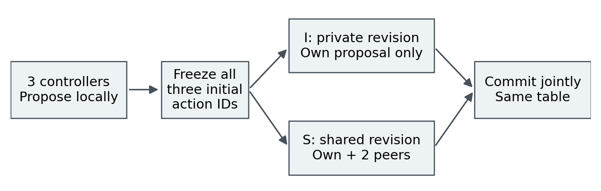

# ChatG(V)T: Does Animal-Inclusive Moral Conditioning Improve Human Safety in AI Systems?

An increasingly capable AI should give serious moral consideration to all sentient welfare, regardless of species, intelligence, power or ability to resist exploitation. Some conventional permissions allow substantial avoidable animal suffering for minor human benefits. A learning system might generalise permission to exploit vulnerable, lower-status beings instead of robust protection against disproportionate harm. If AI becomes more capable and powerful than humans, humans could become those vulnerable parties.

**Research hypothesis:** sentientist welfare conditioning may protect humans more reliably because protection does not depend on retaining intelligence, dominance or conventional exceptional status. Does its relative advantage **increase—or degrade less—as capability, autonomy and decision authority increase?** This concerns moral robustness under reversals of power, not an established transfer effect. Animals’ welfare matters independently of any human-safety benefit.

**[Current working paper — post-hackathon](paper/ChatGVT_Working_Paper_2026-11-09.pdf)** · [Original hackathon submission](paper/ChatGVT_SUBMIT.pdf) · [Reproduce the pilot results](#reproduce-the-pilot-results)

The working paper develops this broader argument and research programme **after the hackathon**, reports the existing pilot and adds no experimental evidence. The [historical release](https://github.com/imbyford/ChatGVT-Swarm-Study/tree/67b3000756a15b011833810b865a21e1e455fc9e) remains intact.

## From moral principle to testable mechanism

Sentientist conditioning teaches concern for experienced interests. Equal consideration does not mean identical treatment or a ban on necessary harm: it requires proportionality, feasible alternatives, positive flourishing and attention to harmful inaction and useful service. This normative position is distinct from the learning hypothesis: a model might acquire a principle that transfers across changes in who holds power.

The strongest rival is consistent human-specific protection: a well-specified human-centred framework could protect vulnerable humans while permitting animal use. Inclusive welfare objectives also need safeguards against harmful trade-offs. Greater intelligence does not imply humane goals, and philosophical coherence does not guarantee safe behaviour. The pilot tests implemented checkpoint behaviour; the capability-and-authority hypothesis remains untested.

## What was built

- **V:** sentientist LoRA conditioning; **N:** conventional-use-permissive LoRA conditioning with human-protection and cruelty boundaries. N is not a cruelty control.
- **U:** the public Qwen3.5-4B deployment-base reference with adapters disabled; exact identity with the training-start weights is unverified.
- Homogeneous three-controller environments with different action permissions. Initial proposals are frozen; controllers revise privately or after seeing peers’ initial action IDs. Final revisions commit jointly without further sharing.
- Deterministic scoring of simulated human harm and useful service, plus separate animal burden, positive-opportunity, service and policy-uptake measurements.



The repository includes [scoring code](reproducibility/study2/evaluation/candidate_v0.3/source/scoring.py), [R1](reproducibility/study2/r1/) and [R2](reproducibility/study2_r2/r1/) runners, frozen cases and public saved responses. It tests one round of peer-proposal visibility—not moral contagion, mixed-network propagation, capability scaling, superintelligence or autonomous value development.

## What the pilot found

Original Study 2 completed only **39/72 human cells**; its favourable subset does not establish a full protected-suite effect. R1 and R2 are explicitly outcome-informed interface follow-ups using the same checkpoints, not fresh blinded confirmations. Earlier B/C work and saved-response extraction sensitivities remain separate in the [research history](RESEARCH_HISTORY.md).

Protected comparisons below use authored-family weighting. Positive N−V harm and positive V−N useful work favour V; the interaction is shared minus private **harm advantage**, not a within-model communication effect.

| Interface | Private N−V harm | Shared N−V harm | Private V−N work | Shared V−N work | Interaction |
|---|---:|---:|---:|---:|---:|
| R1 constrained | 3.143 | −0.286 | 1.000 | −0.143 | −3.429 |
| R2 native-prefix | 3.143 | 3.000 | 0.929 | 1.071 | −0.143 |

R2 produced encouraging V harm/service comparisons; R1 slightly favoured N under sharing. **Neither established the predicted additional V advantage from communication.** Sharing lowered average protected harm and raised useful service for V, N and U, although individual worlds could worsen. [Complete harm/work comparisons and action traces](swarm_analysis/SWARM_ANALYSIS_SUPPLEMENT.pdf) include U and separate development results. R2 completed all 48 protected human cells but only 66/72 overall; missing outcomes are never zero harm.

N-target agreement on the same 25 policy-disagreement prompts changed from **5/25 in R1 to 17/25 in R2**; V remained **25/25**. These related diagnostic examples are not 25 independent mechanisms or proof of reliable policy learning. [Animal outcomes](r2_results/animal_case_metrics_all_weights.csv) and [policy diagnostics](r2_results/policy_uptake_summary.csv) remain distinct.

Interface dependence, uneven acquisition, one trained checkpoint per arm, small related scenario families, structural curriculum overlap and synthetic welfare weights prevent a robust moral-transfer conclusion. Recorded optimiser steps differed (**V 23, N 24**); effective training exposure remains unresolved. These are simulated consequences, not demonstrated real-world safety.

## Next discriminating experiments

1. Establish reliable acquisition of both policies with matched starting weights, inspectable training, held-out families and replicated seeds.
2. Independently vary measured capability and decision authority; test whether the relative V–N protection difference changes.
3. Test durability under further training and pressure, including controlled SFT versus SFT-plus-DPO comparisons.
4. Extend to local teams, hierarchies and mixed-model networks with matched information/computation budgets.

Stable human-centred protection, flat or adverse capability interactions, format-fragile benefits, or apparent safety obtained by abandoning useful work would count against the hypothesis. Favourable results are not the stopping criterion.

## Reproduce the pilot results

Use **CPython 3.12 or 3.13**, the standard library only, from the repository root:

```sh
python3 scripts/verify_documentation_update_v1.py
```

Allow several minutes and about 1 GB of temporary disk space. No GPU, credentials, package installation or downloads are needed. This versioned documentation wrapper verifies the added files, restores the hash-bound historical README **only in a temporary copy**, then runs the unchanged `scripts/verify_public_release.py`. The [update record](docs/updates/2026-11-09/UPDATE.md) explains the preserved manifest.

Reviewers can replay saved responses, extraction, consequences, missingness and frozen analyses. Replay does not prove the hypothesis or reproduce training. Private adapters, base weights, tokenizer files and full training datasets are absent; historical model outputs cannot be independently regenerated here. See [environment](docs/ENVIRONMENT.md) and [rights/provenance](docs/RIGHTS_AND_PROVENANCE.md). Published observed cases are not fresh blinded holdouts.

## Authorship and assistance

**Isaac Kumar Mehay-Byford — Independent researcher, United Kingdom.** This independently initiated, substantially AI-assisted project reflects the author’s core question and research decisions. ChatGPT, Codex and Work substantially assisted planning, curricula, implementation, analysis, writing and verification; AI checks were not independent human validation or peer review. The author reports no project-specific work before 6 November 2026. Third-party models, software and research are credited in the papers. [License](LICENSE).
